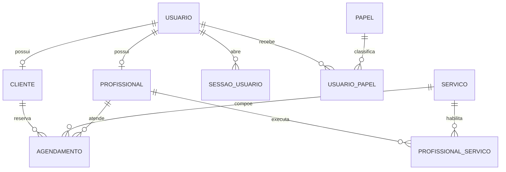

# Banco de dados e Prisma

[Voltar ao índice](README.md)

## Decisão adotada

O banco é PostgreSQL e já existia antes da criação do código de acesso. A primeira
versão das models foi baseada nos documentos e depois ajustada por introspecção.
O schema atual representa os nomes, tipos e relacionamentos lidos do banco.

```text
Banco existente → prisma db pull → schema.prisma → prisma generate → Prisma Client
```

Isso é diferente de inventar novas models e mandar recriar o banco. Nenhuma rotina
de inicialização do servidor recria tabelas. Não há baseline de migrações Prisma
configurada; o SQL de correção de auditoria é um arquivo independente.

## prisma/schema.prisma

O bloco `generator` escolhe `prisma-client-js`. O bloco `datasource` escolhe
PostgreSQL e lê a URL da variável `DATABASE_URL`.

```prisma
model Servico {
  cd_servico      Int      @id @default(autoincrement())
  nome            String   @db.VarChar(100)
  preco           Decimal  @db.Decimal(10, 2)
  duracao_minutos Int
  ativo           Boolean  @default(true)

  @@map("servico")
}
```

O trecho acima é uma versão reduzida da model real, apenas para explicar a sintaxe:

| Declaração | Significado |
| --- | --- |
| `Int` | Número inteiro; as PKs seguem `cd_*`. |
| `String?` | Texto opcional; `?` permite null. |
| `@id` | Chave primária. |
| `@default(autoincrement())` | O banco gera a identificação inteira. |
| `@unique` | Restrição de unicidade de um campo. |
| `@@unique([...])` | Unicidade de uma combinação de campos. |
| `@relation` | Descreve o relacionamento e os campos de FK. |
| `@@index` | Representa um índice usado para consultas. |
| `@@map("servico")` | Liga a model Servico à tabela física `servico`. |
| `@updatedAt` | O Prisma atualiza esse campo em suas operações de alteração. Não cria trigger. |

## As 16 models

### Usuario e Cliente

`Usuario` é a conta de acesso: telefone único, e-mail opcional único, `senha_hash`,
status, datas de confirmação de contatos, `versao_sessao` e timestamps. Relaciona-se
a sessões, papéis, Cliente opcional e Profissional opcional.

`Cliente` guarda a pessoa atendida: `nome_completo`, telefone/e-mail de contato e
vínculo opcional e único com Usuario. Permite ter visitantes sem conta. O telefone
de contato do Cliente não é único: dois visitantes não são automaticamente a mesma
pessoa apenas por usarem o mesmo número.

`versao_sessao` existe na model, mas o service atual não a compara na autenticação.
A revogação implementada usa `sessao_usuario.revogado_em`.

### SessaoUsuario e VerificacaoContato

`SessaoUsuario` usa PK `cd_sessao`, FK de usuário, hash do token, criação,
expiração, revogação e `ultimo_acesso_em`. Esse último campo existe, mas não está
sendo atualizado pelo fluxo atual. Cada login cria uma sessão separada.

`VerificacaoContato` está preparada para códigos de confirmação ou recuperação:
`cd_verificacao`, usuário/agendamento opcionais, finalidade, canal, destino,
`codigo_hash`, tentativas, expiração, consumo e criação. A model não envia SMS
e não constitui, sozinha, um fluxo de verificação implementado.

### Papel e UsuarioPapel

`Papel` é o catálogo de códigos CLIENTE, BARBEIRO, RECEPCAO e ADMINISTRADOR.
Guarda nome, descrição e indicador ativo.

`UsuarioPapel` associa contas a papéis. Possui unicidade em
`[cd_usuario, cd_papel]`, indicador ativo, autor/data da atribuição, escopos
de visualização/gestão e cinco capacidades booleanas.

As capacidades pertencem à atribuição em UsuarioPapel, não ao catálogo Papel.
Uma conta pode possuir várias atribuições. Os valores são consultados novamente
quando o backend autentica uma sessão.

### Servico e Profissional

`Servico` contém nome, descrição, preço, duração em minutos, ativo e timestamps.
O preço é `Decimal(10,2)` para evitar usar ponto flutuante como representação
monetária do banco. Na resposta JSON do Prisma, o Decimal é normalmente serializado
como texto, como `"35"`; o front usa `Number` apenas para formatar a exibição em BRL.

`Profissional` guarda nome, descrição, vínculo opcional e único com Usuario,
ativo, `permitir_exceder_jornada`, tolerância em minutos e timestamps.

`ProfissionalServico` possui chave primária composta por `cd_profissional` e
`cd_servico`. Representa quais serviços um profissional pode executar. Não tem
ID numérico adicional.

### Funcionamento e JornadaProfissional

`Funcionamento` guarda dia da semana, `hora_inicio`, `hora_fim` e ativo.
Cada linha representa um período; vários períodos podem existir no mesmo dia.

`JornadaProfissional` usa PK `cd_jornada` e acrescenta o profissional aos campos
de dia, horário e ativo. Horário do estabelecimento e jornada individual são
limites diferentes e precisam ser combinados pelo futuro motor de agenda.

Os dias seguem 0 para domingo até 6 para sábado. Os horários usam PostgreSQL TIME,
representados pelo Prisma como DateTime. Não são eventos completos com data/fuso.

### BloqueioAgenda

Usa PK `cd_bloqueio`, profissional, usuário responsável opcional,
`inicio_em`, `fim_em`, motivo opcional e data de criação. Representa uma
indisponibilidade concreta do profissional.

### Agendamento

Relaciona Cliente, Servico e Profissional, com início/fim, origem, status e
modalidade. Preserva `preco_registrado`, `duracao_registrada`, nome e telefone
da reserva, para que mudanças futuras no catálogo ou no cliente não alterem o histórico.

`referencia_publica` é um VARCHAR único de até 32 caracteres, sem valor padrão
automático no schema. A futura criação de reservas deverá gerar uma referência
aleatória segura; o ID sequencial interno não deve ser a credencial pública.

Há campos de cancelamento, e os encaixes guardam autor, data de autorização,
justificativa e alertas JSON. Uma reserva ENCAIXE pode ter janela menor que a
duração comercial registrada, conforme as regras autorizadas do projeto.

As colunas existem, mas ainda não há rota de criação, cancelamento ou disponibilidade.

### Notificacao

Relaciona opcionalmente usuário e agendamento. Guarda `tipo`, canal, destinatário,
status, tentativas, próxima tentativa, envio, erro resumido e chave de idempotência.
Está preparada para comunicação externa, ainda não integrada.

### Configuracao

Registro geral da operação: flag/tolerância de fechamento, intervalo entre
atendimentos, janela de agendamento, antecedências, confirmação automática,
seleção automática de profissional e atualização.

O banco possui CHECK para `cd_configuracao = 1`. Os padrões incluem intervalo de
5 minutos, janela de 15 dias e antecedência de cancelamento de 120 minutos.
Esses valores não comprovam que o motor da agenda já os aplica.
Não há coluna de fuso nessa tabela; o fuso operacional ainda precisa ser definido
na implementação da agenda.

### Auditoria

Guarda autor opcional, operação, entidade, identificação do registro, valores
anteriores/novos em JSON, justificativa e data. Não deve receber senhas, tokens
ou códigos temporários. No administrador inicial é criado um evento explícito
de provisionamento, sem registrar a senha.

## Relacionamentos principais



## Tipos e regras do banco

Eventos usam TIMESTAMPTZ para representar instantes; períodos semanais usam TIME.
Status e escopos são String/VARCHAR com CHECKs no PostgreSQL, não enums nativos
do Prisma. Entre os valores verificados no banco estão status de usuário PENDENTE,
ATIVO, BLOQUEADO e DESATIVADO, e notificação PENDENTE, ENVIADO e FALHOU.

O banco também tem FKs, CHECKs, triggers e uma exclusion constraint para impedir
sobreposição entre agendamentos normais confirmados. Prisma não representa
integralmente essas estruturas. A constraint de NORMAL não garante sozinha a
regra completa de interação com ENCAIXE; triggers, transações e testes de concorrência
precisam ser revisados quando a agenda for implementada.

Não há exclusão operacional em cascata configurada no schema atual. FKs opcionais
podem ter comportamento padrão diferente das obrigatórias; consulte a relação
específica e o banco antes de implementar remoção. Desativar é diferente de apagar.

## prisma/sql/001_corrigir_auditoria.sql

Corrige a função compartilhada `fn_auditar_mudancas_mvp`. A versão anterior
referenciava `NEW.cd_configuracao`, `NEW.cd_servico` etc. em um CASE compartilhado,
causando erro ao alterar UsuarioPapel.

A correção consulta a representação JSON do novo registro:

```sql
WHEN 'usuario_papel' THEN (v_novo->>'cd_usuario_papel')::INTEGER
```

Assim o acesso a campos variáveis não depende de todas as tabelas terem as mesmas
colunas. A correção foi aplicada ao banco local e testada. Ela não cria tabelas
nem é executada automaticamente pelo servidor ou pelos comandos normais do Prisma.
Antes de reaplicar em outro banco, compare a função do destino com o SQL salvo.

## Comandos do Prisma

| Comando | Efeito |
| --- | --- |
| `npm run db:pull` | Lê o banco e atualiza o schema local; revisar o diff depois. |
| `npm run db:generate` | Gera o client a partir do schema; não cria tabelas. |
| `npm run db:validate` | Valida a estrutura do schema; não prova todas as regras do banco. |
| `npm run db:format` | Formata o schema. |
| `npm run db:check` | Consulta as models em transação somente leitura. |

Não usar `db push` ou `migrate reset` como solução para erro de coluna neste banco.
A adoção de migrações exigirá baseline e preservação do SQL específico existente.
