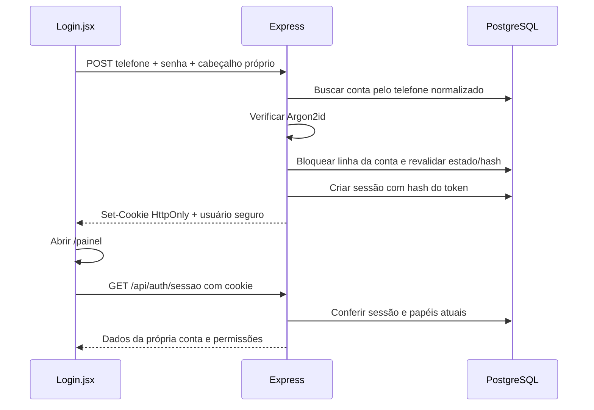

# Autenticação e permissões

[Voltar ao índice](README.md)

Autenticação identifica a conta; autorização decide o que ela pode fazer.
O projeto usa autenticação própria no Express com Prisma/PostgreSQL. Não usa JWT,
Supabase Auth ou autenticação de terceiros no fluxo atual.

## Cadastro público

```text
Cadastro.jsx → POST /api/auth/cadastro → authController.cadastrar
→ authService.cadastrar → transação PostgreSQL
→ Usuario PENDENTE + Cliente + papel CLIENTE
```

O service normaliza telefone, valida nome, senha e e-mail opcional, gera Argon2id e
cria os três registros na mesma transação. Ou todos são confirmados, ou a operação
é desfeita. Nome aceita de 3 a 150 caracteres; senha de 8 a 128. E-mail é convertido
para minúsculas e espaços externos são removidos; senha não recebe trim.

O catálogo precisa conter CLIENTE ativo. O cadastro não cria esse papel sozinho.
Campos extras enviados pelo navegador, como ADMINISTRADOR ou status ATIVO, não
são usados. O telefone é único na conta; não há união automática com visitantes.

A resposta é genérica, inclusive em conflito de unicidade. Isso reduz a exposição
de quais contatos já possuem conta. Status 202 não é prova de ativação nem de envio
de SMS. Ainda faltam código temporário, provedor de SMS, confirmação e reenvio.

## Normalização de telefone

```text
(11) 99999-0000 → +5511999990000
11999990000    → +5511999990000
5511999990000  → +5511999990000
```

Números nacionais com 10/11 dígitos e sem `+` recebem o código brasileiro 55.
Números internacionais com `+` mantêm seu código. O service verifica formato e
comprimento de 10 a 15 dígitos finais, começando por dígito diferente de zero.
Essa validação não comprova que o telefone existe ou pertence à pessoa.

## Proteção da senha

O banco guarda `senha_hash`, não a senha original. Argon2id gera uma representação
com salt e parâmetros para posterior verificação. Os parâmetros atuais são
19.456 KiB de memória, duas passagens e paralelismo 1.

`argon2.verify(hash, senha)` verifica a senha informada. Não existe uma operação
de descriptografar o hash para recuperar a senha original. Mostrar senha no front
só muda o tipo do input; não busca senha do banco.

Login aceita senha entre 1 e 128 caracteres para verificar credenciais existentes;
cadastro exige pelo menos 8 e o administrador inicial exige pelo menos 12.
O fallback de hash simulado faz trabalho de verificação mesmo para telefone
inexistente, reduzindo diferenças óbvias de tempo. Não é garantia de tempo idêntico.

## Login



Depois de validar a senha, a transação usa `SELECT ... FOR UPDATE` na linha do
usuário. Reconfere o hash para recusar login se a senha mudou entre as consultas.
Também exige status ATIVO e `telefone_verificado_em` preenchido.

Telefone inexistente e senha errada retornam 401 com a mesma mensagem. Conta
pendente ou sem acesso retorna 403 depois que a senha correta foi verificada.

## Cookie e sessão

Um token novo é gerado com `randomBytes(32)`, ou 256 bits aleatórios. A representação
hexadecimal tem 64 caracteres. O token original vai para o cookie; o banco recebe
seu hash SHA-256. A resposta JSON contém usuário e expiração, não o token.

| Opção | Aplicação |
| --- | --- |
| HttpOnly | O JavaScript do site não lê o cookie pelo document.cookie. |
| SameSite=Lax | Restringe envio em certos contextos entre sites. |
| Secure | Ativo em produção; exige HTTPS para o envio normal. |
| Path=/ | Cookie vale para o caminho da aplicação. |
| Sem Domain | Não amplia explicitamente o cookie para outros domínios. |
| Nome em desenvolvimento | `champions_session` |
| Nome em produção | `__Host-champions_session` |

A duração é absoluta de sete dias: não há renovação por atividade ou timeout por
ociosidade implementados. Vários dispositivos podem manter sessões distintas.

`autenticar` verifica formato do token, existência da sessão, expiração, revogação
e conta ativa/verificada. Papéis ativos também são consultados novamente. Cookie
presente, por si só, não significa sessão válida.

Logout atual marca a sessão como revogada e limpa o cookie. Logout de todos marca
todas as sessões abertas da conta. Os registros não são apagados. Não há job
implementado para limpeza de sessões antigas.

`ultimo_acesso_em` e `versao_sessao` existem no banco, mas não são usados para
validar ou renovar sessões neste código. Uma futura troca/recuperação de senha
precisará revogar as sessões anteriores explicitamente na mesma transação.

## Proteção de escrita e abuso

Operações POST de autenticação exigem JSON e o cabeçalho
`X-Requested-With: ChampionsBarber`. Requisições marcadas como cross-site são
recusadas; quando Origin existe, ele precisa constar em APP_ORIGINS.
Clientes de servidor sem Origin podem chamar a API com os cabeçalhos exigidos.

O cabeçalho próprio, a política de origem, a ausência de CORS aberto e os cookies
formam a proteção atual contra requisições indevidas do navegador. HttpOnly
sozinho não impede CSRF ou todas as consequências de XSS.

O login tem limites por IP e telefone, e o cadastro por IP. Consulte os números
no [guia do backend](02-backend.md). Não há bloqueio permanente de conta por
tentativas, CAPTCHA ou store de limites compartilhado entre instâncias.

## Papéis e escopos

| Papel | Sentido no produto |
| --- | --- |
| CLIENTE | Conta do cliente e acesso aos próprios dados. |
| BARBEIRO | Profissional com operações concedidas na agenda. |
| RECEPCAO | Atendimento e gestão de agenda conforme autorização. |
| ADMINISTRADOR | Administração geral. |

Uma conta pode combinar papéis. `usuarioPublico` une concessões ativas, com
ordem de escopos `SEM_ACESSO < PROPRIOS < GLOBAL`. Leitura e gestão são calculadas
separadamente. PROPRIOS exige vínculo com Profissional ativo e refere-se à agenda
desse profissional, não às reservas criadas por ele.

As capacidades independentes são criar agendamento, cancelar, atualizar status,
bloquear agenda e criar encaixe. Uma concessão operacional exige escopo de gestão
válido; o administrador recebe capacidades e escopos globais no cálculo.

O middleware `exigirPapel` verifica os papéis que a rota indicar. Ele não adiciona
implicitamente ADMINISTRADOR a toda lista; uma rota deve declarar quem pode entrar.
O cálculo de permissões não cria as operações administrativas nem implementa
automaticamente filtros de agenda. Esses endpoints ainda serão desenvolvidos.

## Administrador inicial

`npm run admin:criar` é executado localmente na raiz do projeto. O script lê
ADMIN_NOME/ADMIN_TELEFONE quando presentes ou pergunta os valores. A senha e sua
confirmação são digitadas sem eco no terminal e não são colocadas em argumento
de comando, arquivo de código ou log.

O service cria a conta ATIVO, marca a verificação administrativa de telefone,
atribui ADMINISTRADOR com escopos globais e registra auditoria da origem local.
É uma exceção controlada para provisionar o responsável inicial; não é SMS.

A trava consultiva do PostgreSQL serializa chamadas do próprio provisionamento.
Se já há qualquer atribuição ADMINISTRADOR, inclusive inativa, o comando recusa
nova criação. Também recusa telefone já cadastrado. Não é um mecanismo de redefinição
de senha, promoção de conta existente ou recuperação de administrador perdido.

O administrador inicial e os administradores futuros usam o mesmo papel existente;
não há um papel separado chamado DESENVOLVEDOR ou SUPERADMIN.

## Limites que precisam ser lembrados

- A gestão de contas/papéis pelo painel ainda não foi implementada.
- Cadastro público novo não completa ativação sem o futuro fluxo de telefone.
- Recuperação de senha, confirmação de e-mail e alteração de contato ainda faltam.
- A API não confia nas permissões exibidas pelo frontend.
- HTTPS, origem de produção, política de proxy e dependências precisam de revisão
  antes da publicação; o funcionamento local não comprova prontidão de produção.
