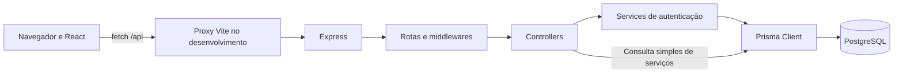

# Documentação do Champions Barbearia

Esta documentação explica o código implementado até 25 de novembro de 2026.
Foi organizada para estudar o projeto, localizar responsabilidades e continuar o
desenvolvimento sem confundir funcionalidades planejadas com funcionalidades prontas.

O projeto já consulta serviços no PostgreSQL, possui site em React, cadastro público,
login por telefone e senha, sessões por cookie e criação local do primeiro administrador.
O painel atual é uma página da própria conta; ainda não é um painel de gestão da barbearia.

## Ordem de leitura

| Documento | O que você vai aprender |
| --- | --- |
| [01 Estrutura de pastas e arquivos](01-estrutura.md) | Onde está cada parte, o que editar e quais arquivos são gerados. |
| [02 Backend](02-backend.md) | Como Express, rotas, controllers, middlewares e services trabalham juntos. |
| [03 Banco e Prisma](03-banco-e-prisma.md) | As 16 models, seus campos e relacionamentos, introspecção e auditoria. |
| [04 Frontend](04-frontend.md) | Como cada tela funciona, estados React, estilos, navegação e API. |
| [05 Autenticação e permissões](05-autenticacao.md) | Senhas, sessões, administrador inicial, papéis, escopos e limites atuais. |
| [06 Contratos da API](06-api.md) | Endpoints, requisições, respostas e códigos HTTP. |
| [07 Execução e testes](07-execucao-e-testes.md) | Instalar, iniciar, configurar, testar e investigar problemas. |
| [08 Evolução e pendências](08-evolucao-e-pendencias.md) | O que já foi feito e a sequência de desenvolvimento que ainda falta. |
| [09 Guia de leitura do código](09-guia-do-codigo.md) | Sintaxe e conceitos usados, com exemplos comentados. |

## Como as partes se conectam

Na autenticação, a sessão liga uma requisição à conta existente no banco.
O navegador guarda um identificador em cookie HttpOnly; o servidor confere a sessão
e consulta os papéis atuais antes de devolver dados privados.

## Recursos disponíveis

| Recurso | Situação |
| --- | --- |
| Home e catálogo público | Implementados, com consulta real de serviços ativos. |
| Login por telefone e senha | Implementado e conectado ao frontend. |
| Cadastro de cliente | Conectado; cria conta PENDENTE sem ativação automática. |
| Conta administrativa inicial | Criada pelo comando local; login testado pelo responsável. |
| Minha conta em `/painel` | Consulta sessão, mostra dados/perfis e permite logout. |
| Permissões | Cálculo e middleware de papéis implementados; operações futuras devem aplicá-los. |
| SMS, confirmação de telefone e recuperação de senha | Ainda não implementados. |
| Gestão de usuários, serviços e profissionais | Ainda não implementada. |
| Disponibilidade, reservas e encaixes via API/interface | Ainda não implementados, apesar das tabelas existentes. |

## Onde procurar uma mudança

| Necessidade | Arquivos principais |
| --- | --- |
| Alterar cores e layout | `frontend/src/style.css` |
| Alterar a página inicial | `frontend/src/App.jsx` |
| Alterar login ou cadastro | `frontend/src/Login.jsx`, `frontend/src/Cadastro.jsx` |
| Alterar validação de credenciais ou sessões | `src/services/authService.js` |
| Restringir uma futura rota a administrador | `src/middlewares/authMiddleware.js` e a rota correspondente |
| Ver campos de uma tabela | `prisma/schema.prisma` |
| Iniciar o app ou consultar scripts | `package.json` e `frontend/package.json` |

Não há credenciais reais nesta documentação. Exemplos usam dados fictícios.
O `.env` local não deve ser copiado para documentos, prints ou commits.

Esta pasta `docs` é o guia técnico do código. A pasta `src/doc` contém os documentos
originais de planejamento e é ignorada pelo Git. Os guias curtos já existentes em
`src/models/README.md`, `src/routes/auth.md` e `frontend/README.md` continuam no projeto;
esta pasta reúne a explicação detalhada.
